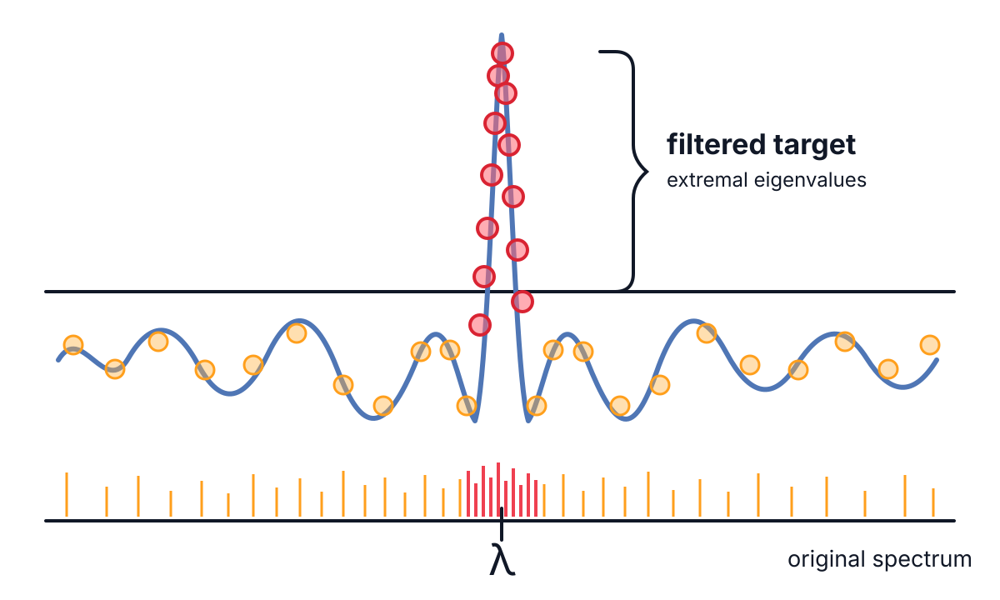

# Polfed.jl

[](https://github.com/RockClimbingRocks/Polfed.jl/actions)
[](https://rockclimbingrocks.github.io/Polfed.jl/)
[](LICENSE)

<p align="center">
  <picture>
    <source media="(prefers-color-scheme: dark)" srcset="docs/src/assets/logo-dark.svg">
    <source media="(prefers-color-scheme: light)" srcset="docs/src/assets/logo.svg">
    
  </picture>
</p>

`Polfed.jl` is a Julia package for polynomial filtering eigensolvers and
Hamiltonian tools for quantum many-body simulations.

<p>
  <a href="https://rockclimbingrocks.github.io/Polfed.jl/"></a>
  <a href="https://rockclimbingrocks.github.io/Polfed.jl/citation/#article"></a>
  <a href="https://rockclimbingrocks.github.io/Polfed.jl/citation/#code"></a>
  <a href="https://github.com/RockClimbingRocks/Polfed.jl"></a>
  <a href="https://scipost.org/submissions/2605.10191v2/"></a>
  <a href="https://arxiv.org/abs/2605.10191"></a>
  <a href="https://juliapkgstats.com/pkg/Polfed?timeframe=30d&trendingPeriod=14d&userData=true&ciData=true&missingData=true"></a>
</p>

If `Polfed.jl` supports your research, please cite both the overview article
and the code. This helps make the method and the software visible, reusable,
and easier to maintain for the community. Citation details are collected on the
[citation page](https://rockclimbingrocks.github.io/Polfed.jl/citation/).

Version of the code: `v1.0.0`

## What Is POLFED?

Polynomial Filtering Exact Diagonalization (POLFED) is designed for eigenvalue
problems of the form

```math
H |\psi\rangle = E |\psi\rangle
```

where only a selected part of the spectrum is desired. The interface allows one
to target arbitrary spectral regions, while the method builds a polynomial
filter that amplifies components of a vector near the target energy $\lambda$ and
suppresses the rest of the spectrum. Krylov/Lanczos-type factorization is then
applied to the filtered problem.

<p align="center">
  <picture>
    <source media="(prefers-color-scheme: dark)" srcset="docs/src/assets/spectral-transform-webpage-dark.svg">
    <source media="(prefers-color-scheme: light)" srcset="docs/src/assets/spectral-transform-webpage-light.svg">
    
  </picture>
</p>

The lower part of the figure shows the original, untransformed spectrum: the
eigenvalues and eigenvectors (shortly the eigenpairs) that one would like to
compute, denoted with red color. The curve above it illustrates the polynomial
transformation used to filter out the desired spectral region. By mapping the
wanted eigenvalues to extremal values (either the largest or the smallest ones),
POLFED makes the target eigenpairs accessible to Krylov/Lanczos-type methods.

The original POLFED method was introduced by Piotr Sierant and collaborators in
[PRL](https://journals.aps.org/prl/abstract/10.1103/PhysRevLett.125.156601)
/ [arXiv](https://arxiv.org/pdf/2005.09534).

For a broader overview and practical discussion, read the `Polfed.jl` article:
[SciPost](https://scipost.org/submissions/2605.10191v2/)
/ [arXiv](https://arxiv.org/abs/2605.10191).

## Features and Capabilities

- One entrypoint per kind of request: a single window
  ([POLFED](https://rockclimbingrocks.github.io/Polfed.jl/tutorials/polfed/)), two windows at once
  ([Double POLFED](https://rockclimbingrocks.github.io/Polfed.jl/tutorials/double-polfed/)), a wide window split into narrow
  patches ([Patched POLFED](https://rockclimbingrocks.github.io/Polfed.jl/tutorials/patched-polfed/)), and the whole spectrum
  ([Full POLFED](https://rockclimbingrocks.github.io/Polfed.jl/tutorials/full-polfed/)).
- Targets are given as a number of states around an energy or as an energy window; the
  filter, its polynomial order and the Krylov budget are resolved automatically from a
  KPM density of states. See [The workflow](https://rockclimbingrocks.github.io/Polfed.jl/how-polfed-works/) and
  [Filters](https://rockclimbingrocks.github.io/Polfed.jl/how-polfed-works/filters/).
- Works on a sparse matrix or on your own matrix-free operator `f!(Y, X)`; see
  [the operator interface](https://rockclimbingrocks.github.io/Polfed.jl/api/entrypoints/#operator_interface).
- Lanczos and block Lanczos factorizations; see
  [Krylov background](https://rockclimbingrocks.github.io/Polfed.jl/how-polfed-works/krylov/).
- The filter application is the bottleneck, and is attacked with
  [optimized kernels](https://rockclimbingrocks.github.io/Polfed.jl/going-faster/optimized-kernels/),
  [parallelization](https://rockclimbingrocks.github.io/Polfed.jl/going-faster/parallelization/), and
  [CUDA](https://rockclimbingrocks.github.io/Polfed.jl/going-faster/gpu/); see [Going faster](https://rockclimbingrocks.github.io/Polfed.jl/going-faster/).
- Built-in Hamiltonian constructors are provided for
  [Quantum Sun (QSun)](https://rockclimbingrocks.github.io/Polfed.jl/models/qsun/), [XXZ](https://rockclimbingrocks.github.io/Polfed.jl/models/xxz/), and
  [J1-J2](https://rockclimbingrocks.github.io/Polfed.jl/models/j1j2/).
- Results carry a report on the spectral transformation, mapping, convergence, and
  timings; see [Results, Reports, Logging](https://rockclimbingrocks.github.io/Polfed.jl/api/results-reports-logging/).

## Development and Experiments

- [Architecture](docs/src/development/architecture.md) explains the package layers,
  runtime data flow, and numerical invariants.
- [Roadmap](docs/src/development/roadmap.md) records the remaining multi-window,
  filtering, mapping, and Lanczos work.
- [Curated notebooks](notebooks/README.md) preserve the reproducible experiments and
  summarize the useful conclusions from the larger research archive.
- [Reporting example](examples/reporting.jl) provides a small runnable package example.

Run the package checks from the repository root:

```bash
julia --project=. -e 'using Pkg; Pkg.instantiate(); Pkg.test()'
bash docs/build.sh
```
