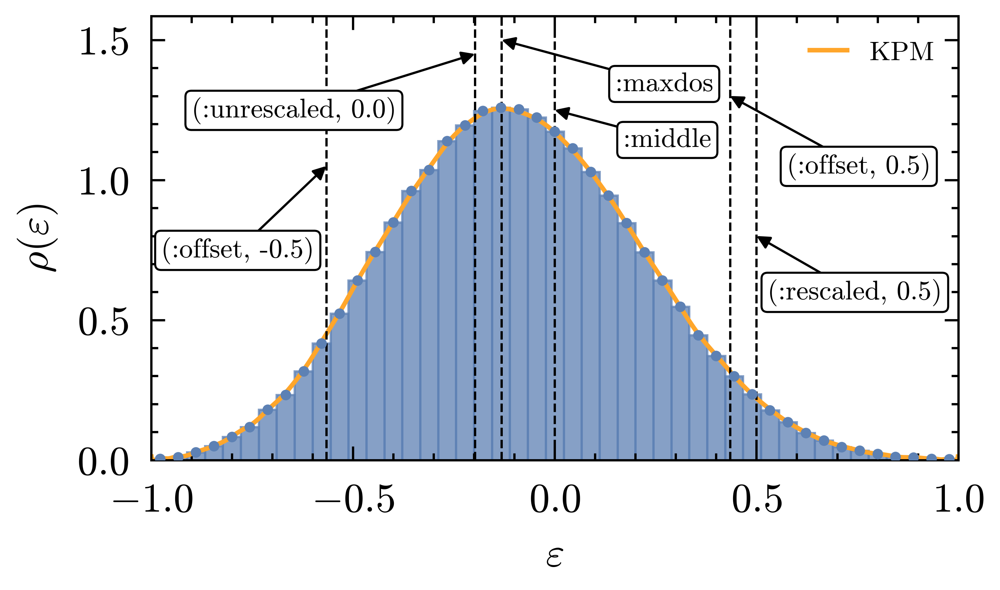

# [POLFED](@id tutorial_polfed)

The canonical single-filter solve: one filter, one window, one Lanczos run. This is the
entrypoint to reach for unless your energy window is very wide (then see
[Patched POLFED](@ref tutorial_patched)) or you want the whole spectrum
([Full POLFED](@ref tutorial_full)).

## Setup

```julia
using UniPolfed
using UniPolfed.Models: qsun_hamiltonian
using LinearAlgebra

L_loc, L_grain, g0, α = 12, 2, 1.0, 0.5
H  = qsun_hamiltonian(L_loc, L_grain, g0, α; use_sparse=true)
x0 = normalize!(rand(size(H, 1)))
```

## The two call forms

```julia
# count target: howmany eigenpairs nearest a point
result = polfed(H, x0, 100, :maxdos)

# window target: every eigenpair inside an interval
result = polfed(H, x0, (-0.5, 0.5))
```

The arity distinguishes them — with `howmany` you get a count target, without it a window
target. In window mode POLFED cannot know in advance how many pairs it will return, so
`length(vals)` is the answer to your question, not a parameter of it.

## [Target modes](@id polfed_targets)

POLFED works internally in rescaled coordinates

```math
\varepsilon = \frac{E - E_c}{\Delta E}, \quad
\Delta E = \frac{E_{\max} - E_{\min}}{2}, \quad
E_c = \frac{E_{\max} + E_{\min}}{2},
```

where ``E_c`` is the **centre** of the spectrum and ``\Delta E`` its **half-width**, so the
smallest and largest eigenvalues map to ``-1`` and ``+1``. Write
``\varepsilon_{\mathrm{maxdos}}`` for the rescaled energy at which the density of states peaks.

Point targets:

- **`:maxdos`** — ``\varepsilon_{\mathrm{maxdos}}``, where the DoS is maximal. Usually what
  "the middle of the spectrum" means physically.
- **`:middle`** — the centre of the unrescaled spectrum, ``E_c``. Identical to
  `(:rescaled, 0.0)`, and in general **not** the same as `:maxdos`.
- **`(:offset, η)`** — interpolate from ``\varepsilon_{\mathrm{maxdos}}`` toward an edge:
  `η = 0` is the DoS maximum, `η = 1` is ``+1``, `η = -1` is ``-1``.

  ```math
  \varepsilon_{\mathrm{target}} =
  \begin{cases}
  \varepsilon_{\mathrm{maxdos}} + \eta\cdot(1-\varepsilon_{\mathrm{maxdos}}),
  & 0 \le \eta \le 1, \\
  \varepsilon_{\mathrm{maxdos}} + \eta\cdot(1+\varepsilon_{\mathrm{maxdos}}),
  & -1 \le \eta < 0 .
  \end{cases}
  ```
- **`E::Real`** or **`(:unrescaled, E)`** — a true energy, converted internally with the
  rescaling above.
- **`(:rescaled, ε)`** — an already-rescaled energy in ``[-1, 1]``, used directly.

**`(:rescaled, 0.5)` and `(:offset, 0.5)` are not the same thing.** `:rescaled` is measured
from the center of the spectrum; `:offset` is measured from the DoS maximum toward an edge.
Confusing the two is the most common way to end up looking at the wrong part of the
spectrum.

```julia
targets = (
    0.0,                # same as (:unrescaled, 0.0)
    :maxdos,
    :middle,
    (:offset, 0.5),
    (:offset, -0.5),
    (:unrescaled, 0.0),
    (:rescaled, 0.5),
)

for t in targets
    result = polfed(H, x0, 80, t)
    @show t, extrema(result.vals)
end
```

```@raw html
<div style="border:1px solid #d0d7de; border-radius:8px; padding:10px; background:#fff;">
  
</div>
```

### [Interval (window) targets](@id polfed_window_targets)

Everything above names a **point**, and `howmany` decides how wide a window grows around it.
The other way round is to name the **interval** yourself and let the count fall out of it:

```julia
# every eigenpair with energy between -0.5 and 0.5
vals, vecs, report = polfed(H, x0, (-0.5, 0.5))
```

There is no `howmany` argument — the arity is what distinguishes the two modes. Accepted
spellings:

| `target_window` | Meaning |
| :--- | :--- |
| `(Elo, Ehi)` | a true-energy interval — the same as `(:unrescaled, (Elo, Ehi))` |
| `(:unrescaled, (Elo, Ehi))` | explicit true-energy form |
| `(:rescaled, (εlo, εhi))` | an interval already in rescaled ``[-1,1]`` coordinates |

Note the shape: the bounds are a **tuple inside** the tagged form, `(:rescaled, (lo, hi))`,
not `(:rescaled, lo, hi)`.

#### Practical notes

- **Narrow windows are expensive.** The order scales as
  ``K \approx 2.655\sqrt{1-\tilde\lambda^2}/\delta`` with ``\delta`` the interval
  half-width, so halving the window doubles the cost of every matvec. Widening one is usually
  cheaper than you expect — see [The bottleneck](@ref going_faster).
- **A window touching a spectrum edge** (reaching ``\pm 1`` in rescaled terms, i.e. `Emin` or
  `Emax`) is served by a monotone [`EdgeFilter`](@ref filters) rather than a delta filter.
- **Results are trimmed to what you asked for.** A filter's passband can come out wider than
  the request; pairs outside your interval are dropped before you see them. That is why a run
  can converge more pairs than it returns — compare `result.converged` with
  `length(result.vals)`.
- **An empty window is not an error.** If no eigenvalues lie inside, you get an empty result
  and a warning, not an exception.

```julia
result = polfed(H, x0, (:rescaled, (0.28, 0.38)))

length(result.vals)   # the answer, not a parameter
result.converged      # ≥ length(vals): converged pairs outside the window were trimmed
```

Patched POLFED has the same split — `patched_polfed(H, x0, howmany_per_patch, target_window)`
is its window form. See [Patched POLFED](@ref tutorial_patched).

### `:maxdos` moves when you change the DoS

`:maxdos` is *defined* as the peak of the KPM estimate, so the two knobs in
[`DoSConfig`](@ref UniPolfed.DoSConfig) can shift it:

- `N` — more Chebyshev moments, finer resolution, often more visible peaks.
- `R` — more stochastic probes, less noise, a more stable peak location.

```julia
result = polfed(H, x0, 80, :maxdos; dosc = DoSConfig(N=400, R=500))
```

If a `:maxdos` run surprises you, raise `N` and `R` and check whether the target moved. The
maths behind the estimate is on [The workflow](@ref how_polfed_works) page.

## Lanczos or block Lanczos

The shape of `x0` decides — nothing else:

```julia
# vector  → standard Lanczos
x0_vec = normalize!(rand(size(H, 1)))
result_l = polfed(H, x0_vec, 100, 0.0)

# matrix → block Lanczos, block size = number of columns
x0_mat = Matrix(qr(rand(size(H, 1), 4)).Q)
result_b = polfed(H, x0_mat, 100, 0.0)
```

The QR is the recommended way to start a block run: the columns need to be mutually
orthonormal, not merely normalized.

Standard Lanczos usually wins on raw FLOPs and is the better default for smaller runs.
Block Lanczos applies the filter to several vectors at once, which uses hardware far better
— this is what pays off on many cores and on GPUs. Keep
``\texttt{howmany}/\texttt{block\_size} \gtrsim 100``; the reasoning
is in [Krylov background](@ref krylov_background) and [Guidelines](@ref guidelines).

## Complex Hermitian operators

Nothing changes. Symmetry-reduced sectors — momentum sectors, for instance — naturally
produce complex matrix elements, and the same interface handles them:

```julia
using SparseArrays

n = 5000
Hc = sprandn(ComplexF64, n, n, 0.01)
Hc = Hc + Hc'
Hc = Hc + spdiagm(0 => randn(Float64, n))

x0c = normalize!(randn(ComplexF64, n))
result = polfed(Hc, x0c, 40, 0.0)
```

`Float32`, `Float64`, `ComplexF32` and `ComplexF64` are all supported.

## Tolerances

```julia
result = polfed(H, x0, 100, :maxdos;
    tol = 1e-15,                # Lanczos breakdown / Ritz tolerance
    eigentol = 1e-10,           # acceptance: ‖H·v − λ·v‖ < eigentol
    overestimate_iters = 1.25,  # Krylov budget inflation factor
)
```

`eigentol` is the one with physical meaning: a pair is accepted only when its residual under
the *original* ``H`` is below it.

## Reading the output

### The result object

[`PolfedResult`](@ref UniPolfed.PolfedResult) destructures as `(vals, vecs, report)` — the same
protocol every other entrypoint and `lanczos` use:

```julia
howmany, target = 100, :maxdos
vals, vecs, report = polfed(H, x0, howmany, target)
```

The full set of fields is available on the object:

```julia
result.vals        # eigenvalues, ascending, true energies of H
result.vecs        # matching eigenvectors
result.residuals   # ‖H·v − λ·v‖ per pair
result.converged   # how many pairs converged (before interval filtering)
result.report      # the structured run report

length(result.vals)          # number of pairs returned
v = eigenvector(result, 1)   # 1st eigenvector, layout-resolved
λ, v = eigenpair(result, 1)  # or both

for i in eachindex(result.vals)
    λ, v = eigenpair(result, i)
    # ...
end
```

!!! note "Eigenvectors are always columns"
    `vecs` is `D × n` and `vecs[:, i]` is the `i`-th eigenvector — for the operator path and the
    matrix path alike. The matrix entrypoints work in row layout internally and return a lazy
    `transpose` of those rows (no copy), so the indexing does not depend on it.
    [`eigenvector`](@ref UniPolfed.eigenvector) gives the same thing as a view.

`vals`/`vecs`/`residuals` are already filtered to the requested interval and sorted with
respect to ``H``. Because the in-interval pairs form a contiguous run, the eigenvector
subset is a **view**, not a copy.

If fewer than `howmany` pairs land inside the interval, POLFED **warns and returns what it
has** — it does not throw. Seeing that warning means the run is telling you something; see
[FAQ](@ref faq).

### [Reading the report](@id polfed_reading_report)

```julia
vals, vecs, report = polfed(H, x0, 100, :maxdos)
display_report(report)
```

Below is a real report from this page's setup scaled down (`L_loc = 6`, `howmany = 20`,
`target = :maxdos`), annotated section by section. Your numbers will differ with the
Hamiltonian, the seed and the hardware, but the four sections are always the same.

```@raw html
<style>
.pf-report {
  --pfr-bg: #f6f8fa; --pfr-fg: #24292f; --pfr-border: #d0d7de;
  --pfr-hd: #0550ae; --pfr-v: #0969a5; --pfr-ok: #1a7f37; --pfr-wn: #9a6700; --pfr-er: #cf222e;
  margin: 1.2rem 0; padding: 0.9rem 1rem; overflow-x: auto;
  border: 1px solid var(--pfr-border); border-radius: 8px; background: var(--pfr-bg);
}
html.theme--documenter-dark .pf-report,
html.theme--catppuccin-frappe .pf-report,
html.theme--catppuccin-macchiato .pf-report,
html.theme--catppuccin-mocha .pf-report {
  --pfr-bg: #15191a; --pfr-fg: #d7dde3; --pfr-border: #58636a;
  --pfr-hd: #79b8ff; --pfr-v: #56d4dd; --pfr-ok: #5ddba0; --pfr-wn: #e0a336; --pfr-er: #ff7b72;
}
/* Documenter styles every .content pre with its own border and background at a
   higher specificity — without !important the report renders as a box in a box. */
.pf-report pre {
  margin: 0 !important; padding: 0 !important;
  background: none !important; border: 0 !important; border-radius: 0 !important;
  font-size: 0.83rem; line-height: 1.5; white-space: pre; color: var(--pfr-fg);
}
.pf-report .pf-hd { color: var(--pfr-hd); font-weight: 700; }
.pf-report .pf-v  { color: var(--pfr-v);  font-weight: 700; }
.pf-report .pf-ok { color: var(--pfr-ok); font-weight: 700; }
.pf-report .pf-wn { color: var(--pfr-wn); font-weight: 700; }
.pf-report .pf-er { color: var(--pfr-er); font-weight: 700; }
.pf-report .pf-b  { font-weight: 700; }
</style>
<div class="pf-report"><pre><span class="pf-hd">Spectral Transformation ────────────────────────────────────────────────</span>
- target: <span class="pf-v">:maxdos</span>
- interval: resc. [<span class="pf-v">+1.56e-01</span>,<span class="pf-v">+2.23e-01</span>], unresc. [<span class="pf-v">+4.66e-01</span>,<span class="pf-v">+7.32e-01</span>]
- filter: <span class="pf-v">DeltaUpFilter</span> · order K = <span class="pf-v">78</span> · cutoff <span class="pf-v">0.14</span>
- mat-vec muls: <span class="pf-v">4_700</span>
<span class="pf-hd">Mapping ────────────────────────────────────────────────────────────────</span>
- operator: <span class="pf-v">generic operator (mul! / user f!)</span>
- layout: <span class="pf-v">RowLayout</span>    block size <span class="pf-v">1</span>    opdim <span class="pf-v">256</span>
- parallel strategy: <span class="pf-v">BlockWise</span>
- Energy: Emin = <span class="pf-v">-4.170</span>   Emax = <span class="pf-v">3.847</span>
<span class="pf-hd">Convergence (block lanczos) ────────────────────────────────────────────</span>
- Number of converged eigenpairs: <span class="pf-ok">20</span> (<span class="pf-v">20</span> requested)
- Ritz  conv tol=<span class="pf-v">1.0e-14</span> passed:  <span class="pf-ok">20</span> (max res. <span class="pf-wn">1.72e-16</span>)
- Eigen conv tol=<span class="pf-v">1.0e-09</span> passed:  <span class="pf-ok">20</span> (max res. <span class="pf-wn">1.12e-13</span>)
- Iterations needed: <span class="pf-b">60</span> (out of <span class="pf-v">68</span> reserved, overestimated by <span class="pf-ok">11.76%</span>)
- Returned set: <span class="pf-ok">certified complete</span>
<span class="pf-hd">Timings ────────────────────────────────────────────────────────────────</span>
- Total polfed run took: <span class="pf-v">5.56 seconds</span> (walltime), <span class="pf-v">5.53 seconds</span> (CPU time)
- Walltime distribution: Lanczos <span class="pf-v">81.29%</span> · preparation <span class="pf-v">18.71%</span>
- Lan walltime: matvec <span class="pf-v">1.59%</span> · reorthog. <span class="pf-v">20.10%</span> · tridiag. <span class="pf-v">11.53%</span> · conv.check <span class="pf-v">66.79%</span>
- Lan CPU time: matvec <span class="pf-v">1.59%</span> · reorthog. <span class="pf-v">20.13%</span> · tridiag. <span class="pf-v">11.45%</span> · conv.check <span class="pf-v">66.82%</span></pre></div>
```

#### Spectral Transformation — what filter got built

The filter is chosen for you, and this section is the receipt.

| Field | Meaning |
| :--- | :--- |
| `target` | your target, as resolved |
| `interval` | the window actually filtered, in **rescaled** ``[-1,1]`` coordinates *and* in true energies. Here `:maxdos` sits at ``\varepsilon \approx 0.19`` — **not** at zero, because the DoS peak is off-centre for this model |
| `filter` | which filter the chain picked. `DeltaUpFilter` = an interior window mapped to ``+1``; an `EdgeFilter` means the window touched ``\pm 1`` |
| `order K` | the Chebyshev order. **Every Lanczos matvec costs `K` sparse products** — the number that governs the run |
| `cutoff` | the threshold a transformed eigenvalue must clear to count as in-window |
| `mat-vec muls` | total sparse ``H\cdot v`` products, ``\approx K \times`` iterations — the honest measure of work |

A large `K` means a narrow window. Raising `howmany` widens it and brings `K` down; see
[The bottleneck](@ref going_faster).

#### Mapping — how the operator was set up

| Field | Meaning |
| :--- | :--- |
| `operator` | `generic operator` means no value-grouped kernel was built. `optimize_mapping=true` on a structured matrix changes this — see [Optimized kernels](@ref optimized_kernels) |
| `layout` | the Krylov layout the run used internally: `RowLayout` on the matrix path, `ColumnLayout` on the operator path. It does **not** affect the returned `vecs`, which are columns either way |
| `block size` | `1` is standard Lanczos. A matrix `x0` with `n` columns makes this `n` |
| `opdim` | the Hilbert-space dimension |
| `parallel strategy` | see [Parallelization](@ref parallelization) |
| `Emin`, `Emax` | the spectral bounds from the initial probe; these define the rescaling. Supply them via `MappingConfig` to skip the probe |

#### Convergence — did it work

| Field | Meaning |
| :--- | :--- |
| `Number of converged eigenpairs` | got what you asked for? A smaller first number is the "fewer than `howmany`" case — see [FAQ](@ref faq) |
| `Ritz conv` | convergence in the **filtered** problem, against `tol` |
| `Eigen conv` | the one with physical meaning: ``\lVert H v - \lambda v\rVert`` against `eigentol`, on the **original** ``H``. A residual of `1e-13` means ~13 good digits |
| `Iterations needed` | the Krylov budget. Used ≈ reserved means the run nearly ran out — raise `overestimate_iters` |
| `Returned set` | `certified complete` means every eigenpair in the interval was found |

#### Timings — where the time went

| Field | Meaning |
| :--- | :--- |
| `Total polfed run took` | wall clock and CPU. On a threaded run CPU ≫ wall; if they match, nothing ran in parallel. CPU time is suppressed on GPU runs |
| `Walltime distribution` | Lanczos versus preparation. Preparation is the bounds probe, the DoS and filter resolution — it should stay a modest slice |
| `Lan walltime` | the split **inside** Lanczos. `conv.check` dominating is typical of a *small* problem; at realistic sizes `matvec` takes over, which is what [Going faster](@ref going_faster) targets |

#### Per-check detail

The convergence history table is hidden by default. Turn it on when a run exhausts its budget:

```julia
display_report(report; convergence_details = true)
```

Writing to a file needs nothing extra — `open(io -> display_report(io, report), "run.txt", "w")`
drops the color automatically. Both switches are also available as IO properties on `show`; see
[Displaying a report](@ref api_display_report). Field-by-field types are in
[Results, Reports, Logging](@ref api_results_reports).

### Logging

Five levels, each strictly adding to the one below:

```julia
UniPolfed.Common.verbosity[] = 0   # silent
UniPolfed.Common.verbosity[] = 1   # warn      — potential issues
UniPolfed.Common.verbosity[] = 2   # info      — one line per pipeline stage
UniPolfed.Common.verbosity[] = 3   # debug     — bound probes, filter ladder, per-check convergence
UniPolfed.Common.verbosity[] = 4   # deep      — per-iteration tracing
```

Level `0` is genuinely silent: POLFED routes its own warnings through
[`polfed_log`](@ref UniPolfed.Common.polfed_log) rather than `@warn`, so they are suppressed
too. Level `4` scales with the run and can produce thousands of lines — use it to find
*where inside a stage* something goes wrong, not for production.

## Next

- [Double POLFED](@ref tutorial_double) — two windows in one call.
- [The operator interface](@ref operator_interface) — drop the matrix and pass `f!` instead.
- [Going faster](@ref going_faster) — when this run is too slow.
- [Patched POLFED](@ref tutorial_patched) — when the window is too wide for one filter.
